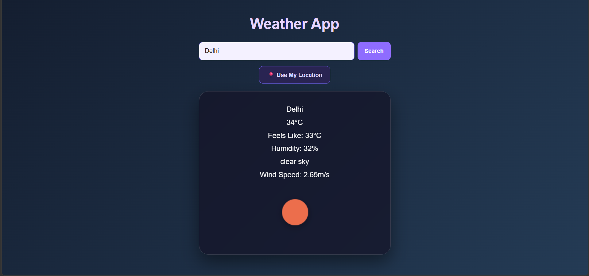
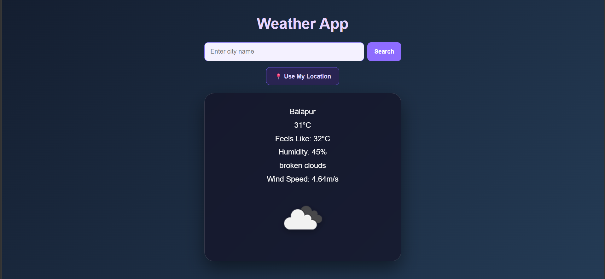

# 🌤️ Weather App

A responsive weather application built using HTML, CSS, and JavaScript.

The app uses the OpenWeatherMap API to fetch weather information based on a searched city or the user's current location.

## 🚀 Features

- 🔎 Search weather by city name
- 📍 Get weather using current location
- 🌡️ Current temperature
- 🌡️ Feels-like temperature
- 💧 Humidity information
- 💨 Wind speed
- ☁️ Weather condition and description
- 🌤️ Dynamic weather icons
- ⌨️ Search using the Enter key
- ⏳ Loading state
- ❌ Error handling for invalid cities and API errors
- 📱 Responsive design for mobile devices

## 🛠️ Technologies Used

- HTML5
- CSS3
- JavaScript
- Fetch API
- OpenWeatherMap API
- Geolocation API

## 📚 What I Learned

While building this project, I practiced:

- Working with REST APIs
- Using `fetch()`
- Using `async/await`
- Handling API responses and errors
- Working with JSON data
- Using the Browser Geolocation API
- DOM manipulation
- Creating reusable JavaScript functions
- Handling user input
- Responsive CSS design

## 📸 Project Preview

### 🔎 City Search

### 📍 Current Location

## 🌐 Live Demo

Coming soon.

## 🔗 GitHub

https://github.com/vinodchintu70/weather-app

## 👨‍💻 Author

**Vinod**

B.Tech AI & Data Science Student